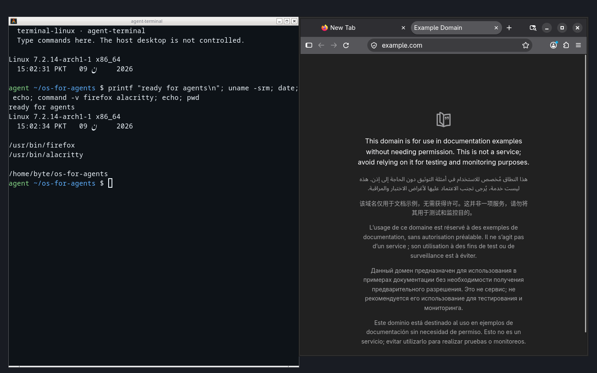
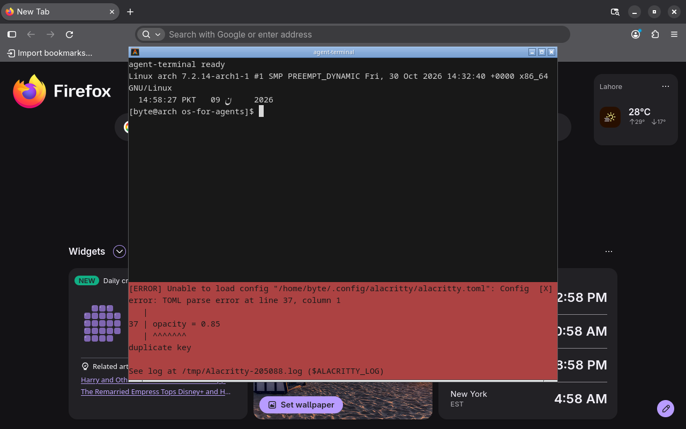

# terminal-linux

**A Linux desktop for AI agents — live in your terminal.**

`terminal-linux` boots a private desktop session, streams it into the terminal, and exposes MCP + CLI tools so agents can click, type, open apps, and run shell commands without touching your host pointer or screen.

Built by [byte4day](https://github.com/byte4day).



<p align="center"></p>

## Features

- Live terminal preview (~20 fps) via a persistent capture stream (not a new screenshot process every frame)
- Visible **agent cursor** overlay so you can see where the agent is pointing
- **Multi-session tabs** — run several named desktops, switch in one terminal (`Alt+←/→`, `Alt+1-9`)
- Drive the same desktop yourself from the terminal (mouse + keys) while agents use MCP
- Own **agent-terminal** + **Firefox** workspace by default
- MCP tools for computer use: screenshot, click, type, windows, clipboard, wait, run_in_terminal, …
- Agent skill + Claude Code plugin marketplace
- One-terminal mode: keep `terminal-linux up` open; agents drive the same session over MCP

> Display isolation only (Xvfb). Same Linux user/filesystem/network as the host unless you add your own sandbox.

## Requirements

| Tool | Why |
|------|-----|
| Linux | host |
| `Xvfb` | virtual display |
| `xdotool` | input |
| ImageMagick | screenshots |
| `openbox` (or vendored copy) | window manager |
| `wmctrl`, `xclip` | window + clipboard helpers |
| Alacritty/Kitty + Firefox | recommended guest apps |

## Install

```bash
git clone https://github.com/byte4day/terminal-linux.git
cd terminal-linux
uv sync
uv tool install -e .
terminal-linux doctor
```

## Quick start

```bash
terminal-linux up
```

One terminal = live computer. Agents attach with MCP:

```bash
claude mcp add terminal-linux -- terminal-linux mcp default
terminal-linux plugins install --all
```

Headless:

```bash
terminal-linux up --no-view
terminal-linux action screenshot --output /tmp/guest.png
terminal-linux action run 'uname -a'
terminal-linux action open-url https://example.com
terminal-linux stop
```

**Ctrl+]** leaves the preview; the session keeps running. Reattach with `terminal-linux watch`.

### Multi-session tabs

```bash
terminal-linux up demo --no-view
terminal-linux up work --no-view
terminal-linux watch demo    # status bar shows tabs; Alt+←/→ or Alt+1-9 to switch
```

Each named session is its own Xvfb desktop. Agents attach with `terminal-linux mcp <name>`.

## Prompt for AI agents (setup)

Copy-paste this into Claude Code, Codex, or any coding agent:

```text
Set up terminal-linux for me on this Linux machine.

Repo: https://github.com/byte4day/terminal-linux
Branch: develop

Do this end-to-end without asking me to run commands manually unless something needs sudo or a login:

1. Clone the repo if needed (or use the current checkout), checkout develop, and create a fresh environment with `uv sync`.
2. Install the CLI on PATH with `uv tool install -e .` (or ensure `.venv/bin/terminal-linux` is usable).
3. Run `terminal-linux doctor` and install any missing host packages you can (Xvfb, xdotool, ImageMagick, wmctrl, xclip, openbox or use the vendored openbox, alacritty/kitty, firefox).
4. Install agent integrations: `terminal-linux plugins install --all` and wire MCP:
   `claude mcp add terminal-linux -- $(command -v terminal-linux) mcp default`
   (or print `terminal-linux mcp --config` and add it to my MCP client config).
5. Smoke-test headless:
   - `terminal-linux up demo --no-view`
   - `terminal-linux action demo windows` (expect agent-terminal + Firefox)
   - `terminal-linux action demo screenshot --output /tmp/terminal-linux-smoke.png`
   - `terminal-linux action demo run 'echo ok && uname -srm'`
   - `terminal-linux stop demo --force`
6. Tell me how to open the live preview (`terminal-linux up`) and how to drive it with MCP tools.
7. Do not push commits or change git remotes unless I ask.

If anything fails, fix it or report the exact blocker (missing sudo, missing package, unsupported terminal for live preview).
```

## Agent tools

| Tool | Purpose |
|------|---------|
| `status` / `up` / `stop` / `ls` | lifecycle |
| `workspace` | ensure agent-terminal + browser |
| `screenshot` | see the screen |
| `windows` / `focus` / `active_window` | window management |
| `open` / `open_url` | launch apps / URLs |
| `run_in_terminal` | shell commands in agent-terminal |
| `click` `move` `drag` `scroll` `type` `key` | input |
| `clipboard_get` / `clipboard_set` | guest clipboard |
| `wait` / `wait_stable` | timing |
| `cursor` | pointer position |

Docs: [docs/AGENT.md](docs/AGENT.md) · [docs/PLUGINS.md](docs/PLUGINS.md) · [skills/terminal-linux/SKILL.md](skills/terminal-linux/SKILL.md)

## License

MIT. Vendored Openbox under `vendor/openbox` remains GPL-2.0.
